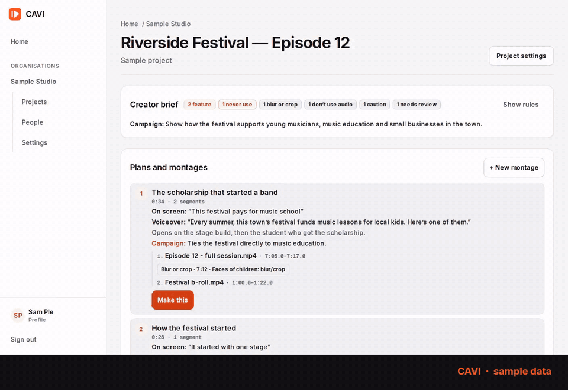

# CAVI

CAVI (pronounced KAH-vee) turns long videos into short clips, following the creator's brief.

Upload a podcast, vlog, interview or stream recording, paste the creator's guidelines, and CAVI finds the moments worth posting. It suggests how to cut them, keeps them away from anything the brief rules out, and renders vertical clips with captions, a hook and an optional AI voiceover, ready to download and post.

[](docs/media/cavi-walkthrough.mp4)

*Walkthrough with sample data. [Watch the MP4](docs/media/cavi-walkthrough.mp4).*

## What CAVI does

CAVI does one thing for now: **clipping**. Live clipping is next.

### Clipping (available)

1. **Upload** a long video. It goes straight to private storage; CAVI checks it and reads its length, size and sound.
2. **Transcribe** it. Every word is timed and each speaker is labelled.
3. **Add the creator's brief.** Paste their guidelines as written. CAVI reads them into rules you can check and edit: moments to feature, moments that must never be used, and things to blur, mute or review. Every time in a rule must appear in the brief, so nothing is invented.
4. **Find clips.** Highlights suggests stand-alone moments, ranked so the creator's priorities come first, each with a reason and how it connects to the campaign. Edit plans goes further and proposes finished short videos: which moments to join and in what order, a hook, and a voiceover script.
5. **Edit.** Join moments from one or more videos, frame each for 9:16, 1:1, 4:5 or 16:9, open on a split screen of several scenes, blur licence plates or faces, mute uncleared music, add a hook, word-by-word or bouncing "pop" captions, an AI voiceover (captioned too), and a sign-off card ("Like and subscribe for more!") the narrator can say.
6. **Render and download.** CAVI renders an MP4 and checks its size, length and sound before keeping it. Download it and post it.

The brief is enforced, not just suggested: a clip that includes a "never use" moment can't be rendered, and clips near anything else the brief flags are marked so someone checks them.

### Live clipping (in development)

Clip live streams while they're happening, from **YouTube**, **Twitch** and **Kick**. The plan:

- Connect a stream you're authorised to clip. Being publicly viewable doesn't give permission to reuse it.
- CAVI follows the stream in short rolling segments, transcribes as it goes, and picks out moments using the same brief rules as recorded video.
- Suggested clips appear while the stream is live, for you to review, edit and render as above.
- Only recent context is analysed each time, never the whole stream, so cost and delay stay bounded.

None of this is built yet.

## How it works

```text
Browser (Next.js) ──▶ Go API ──▶ PostgreSQL (source of truth)
        │                │
        │                └──▶ NATS JetStream ──▶ Media worker (FFmpeg + Gemini)
        │                                            │
        └──── signed uploads/downloads ─────▶ Object storage (R2 / SeaweedFS)
```

- **API** (`apps/api`, Go): sign-in, organisations and permissions, projects, media, briefs, plans, voiceovers and renders. Every request is checked against the organisation's membership and roles.
- **Media worker** (`apps/api/cmd/media-worker`): probes files, transcribes, reads briefs, plans clips, makes voiceovers and renders with FFmpeg. Jobs are stored in Postgres and delivered over NATS, so they survive restarts and retry safely.
- **AI** goes through one boundary (`internal/ai`) and returns structured, validated output. Each organisation chooses from models CAVI has tested: Gemini for transcription, briefs, highlights and plans, and ElevenLabs or Gemini for voiceovers. The AI suggests, people decide: it never runs commands or renders on its own.
- **Web** (`apps/web`, Next.js): the studio where you upload, review the brief, pick clips, edit and download.

## Status

Working: sign-in with Google, organisations and teams with roles, projects with client sharing, uploads, transcription, creator briefs, highlights, edit plans, montages (several moments, split screens, blur, mute, hooks, captions), AI voiceovers and rendering.

Not built yet: live clipping, publishing to TikTok, YouTube or Instagram (download and post for now), editing transcripts and captions, speaker-aware reframing, blur boxes that follow movement, and live job updates (the page polls). The montage editor can't create split screens yet; the API can.

## Run it locally

You need Go 1.26+, Node.js 24+ with pnpm 12+, and Docker.

```bash
make setup          # install dependencies and create env files
make db-up          # PostgreSQL, object storage and NATS
make migrate-up     # database schema
make storage-setup  # once: the media bucket
make media-worker   # FFmpeg + AI worker (needs GEMINI_API_KEY in apps/api/.env)
make api            # API on http://localhost:8080
make web            # web on http://localhost:3000
```

`make check` runs the static checks and tests; `make help` lists every target.

## Documentation

- [Developing CAVI](docs/development.md): setup, the API contract, migrations and environment variables.
- [Reference](docs/reference.md): API endpoints and how auth, briefs, montages, voiceovers, jobs, AI, rendering and media behave.
- [`AGENTS.md`](AGENTS.md): product direction and engineering rules.
- [`packages/contracts/openapi.yaml`](packages/contracts/openapi.yaml): the HTTP API contract.

## Repository layout

```text
apps/api/        Go API and media worker
apps/web/        Next.js web app
packages/        OpenAPI contract and the generated TypeScript client
migrations/      SQL migrations
infrastructure/  Local Docker services and the media worker image
docs/            Developer docs and the walkthrough video
```
